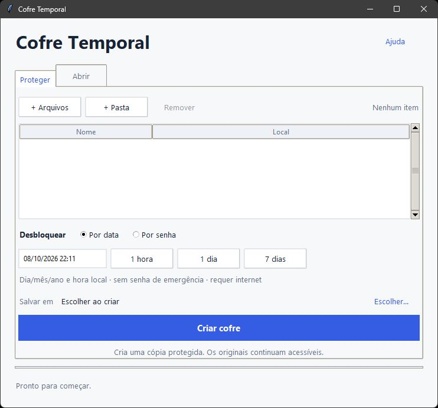

# Cofre Temporal

Um aplicativo para Windows que guarda arquivos e pastas em um cofre com **senha** ou **data de abertura**. A interface é feita em Tkinter e o processamento dos arquivos acontece no próprio computador.



## O que ele faz

| Modo | Resultado | Para abrir |
| --- | --- | --- |
| Por senha | ZIP com conteúdo criptografado em AES-256 | Informar a senha. |
| Por data | Arquivo `.zip.tlock` | Aguardar a data e consultar a rede drand pela internet. |

Também permite selecionar vários arquivos, incluir pastas vazias, cancelar uma operação e restaurar o conteúdo em uma nova pasta. Os resultados aparecem na janela, sem pop-ups de conclusão.

**Os originais são preservados e continuam acessíveis. A proteção vale para a cópia criada.**

## Executar pelo código

Requisitos: **Windows x64**, **Python 3.12+ com Tkinter** e internet para preparar o componente temporal.

Na pasta do projeto, abra o PowerShell:

```powershell
python -m venv .venv
.\.venv\Scripts\python.exe -m pip install -e ".[dev]"
.\.venv\Scripts\python.exe scripts\download_tle.py
.\.venv\Scripts\python.exe -m cofre_temporal
```

O download busca o `tle` na release oficial do drand e confere seu SHA-256. O modo por senha funciona sem esse componente.

## Usar

1. Em **Proteger**, adicione arquivos ou uma pasta.
2. Escolha **Por data** ou **Por senha**. Há atalhos de 1 hora, 1 dia e 7 dias.
3. Clique em **Criar cofre** e salve fora das pastas selecionadas.
4. Em **Abrir**, selecione o cofre e clique em **Abrir e restaurar**.

A data segue o fuso configurado no Windows. Para digitar manualmente, use `DD/MM/AAAA HH:MM`. Arquivos que já existem no destino não são substituídos.

## Como funciona o bloqueio por data

O aplicativo compacta os arquivos e envia esse fluxo ao [tle](https://github.com/drand/tlock), que usa a rede de produção **drand quicknet**. A assinatura necessária à abertura só é publicada na rodada correspondente à data escolhida. A liberação é arredondada para frente em até três segundos.

Os arquivos não são enviados à rede. O programa consulta informações públicas do drand. Mudar o relógio do computador ou editar a data no cabeçalho não fornece a assinatura correta.

Depois da data, **qualquer pessoa com o cofre pode abri-lo sem senha**. Não há senha de emergência. A recuperação depende da rede publicar a assinatura: uma interrupção pode atrasar a abertura; o encerramento da rede antes da rodada pode impedir a recuperação. Guarde uma cópia extra do cofre.

Detalhes sobre os formatos e limites estão em [docs/seguranca.md](docs/seguranca.md).

## Organização

```text
src/cofre_temporal/
    ui.py               Interface e eventos da janela
    vault.py            Criação, criptografia e restauração
    vendor/             Componente temporal e avisos de licença
scripts/
    download_tle.py      Prepara o tle oficial
    build.py             Gera o executável e o pacote portátil
    check_timelock.py     Teste real da liberação por data
tests/                   Testes locais do núcleo e da interface
docs/                    Notas de funcionamento
pyproject.toml           Dependências e configuração do projeto
```

Caches, ambiente virtual, executáveis e pacotes gerados ficam fora do Git. Os arquivos de distribuição são criados em `dist/`.

## Testar

```powershell
.\.venv\Scripts\python.exe -m pytest -q
```

Os testes locais cobrem restauração de arquivos binários e Unicode, senha incorreta, corrupção, cancelamento, caminhos inseguros e os fluxos principais da interface. Os testes de Tkinter precisam de uma sessão gráfica do Windows.

Para testar a integração real com o drand:

```powershell
.\.venv\Scripts\python.exe scripts\check_timelock.py
```

Esse teste cria arquivos temporários, tenta abrir antes da data, espera a liberação e compara o conteúdo restaurado. Ele também verifica adulteração do cabeçalho, conteúdo truncado e compatibilidade com o `tle` oficial. Usa internet e leva aproximadamente 30 segundos, dependendo da rede.

## Gerar o executável

```powershell
.\.venv\Scripts\python.exe scripts\build.py
```

Saídas:

- `dist/CofreTemporal.exe`: aplicativo portátil, sem necessidade de Python instalado.
- `dist/CofreTemporal-Windows.zip`: aplicativo, documentação e licenças.
- `dist/SHA256.txt`: hash do executável.

O executável gerado localmente não tem assinatura digital.

## Componentes

- Python e Tkinter: interface desktop.
- [pyzipper](https://github.com/danifus/pyzipper): ZIP com AES-256.
- [drand/tlock](https://github.com/drand/tlock): criptografia com liberação por tempo.
- PyInstaller: distribuição para Windows.

Os avisos dos componentes estão em [THIRD_PARTY_NOTICES.md](THIRD_PARTY_NOTICES.md).
